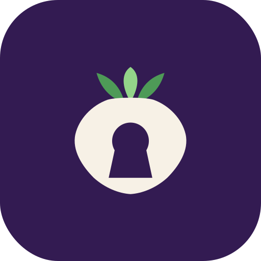

<p align="center">
  
</p>

# Turnypt

*formerly CipherKey — rebranded in v1.0.0; same vault, new name*

[](https://github.com/GigaShalgham/Turnypt/actions/workflows/android-ci.yml)
[](https://github.com/GigaShalgham/Turnypt/releases/latest)
[](LICENSE)
[-green.svg)](app/build.gradle.kts)

**A local-first, permission-free encryption companion for any Android
messenger.**

Turnypt adds end-to-end message encryption to the messaging apps you
already use — SMS, Telegram, WhatsApp, anything that supports standard text
selection or sharing — without any server, account, or network access. You
keep the keyboard you already use: select the text you want to protect, tap
**Encrypt (Turnypt)**, and the draft is replaced with a `TNP1:...`
ciphertext you send as an ordinary message. On the receiving side, select
or share the message, tap **Decrypt (Turnypt)**, enter the shared
passphrase, and read the plaintext preview.

```
Send:    type with any keyboard → select the draft → “Encrypt (Turnypt)” → ciphertext replaces it → send
Receive: select/share the TNP1:... message → “Decrypt (Turnypt)” → passphrase → preview → Copy
```

When an app's selection toolbar is unavailable, the Home screen offers an
**Encrypt clipboard / Decrypt clipboard** fallback ladder.

## Highlights

- **Works with any messenger** — no server, no account, no `INTERNET`
  permission; the app contains no network code at all.
- **Modern authenticated crypto** — AES-256-GCM and ChaCha20-Poly1305
  (RFC 8439; wire id 0x02) with Argon2id (RFC 9106) key derivation,
  each pinned in tests to the RFC's official vectors. An **Automatic**
  mode benchmarks both once on your device and uses the faster; the
  choice travels inside every message, so recipients always decrypt.
- **Image encryption, native** — encrypt photos for the same contacts
  with the same passphrase (chunk-wise-authenticated files; one
  64 KiB chunk in memory at a time, so any file size is safe). Encrypted
  images carry the Turnypt-ecosystem extension — `photo.jpg.tnpi` — and
  anything else stays `.cki`. Reachable from Quick Access, the
  Encrypt/Decrypt tabs (Text | Image switch), the sharesheet, the
  floating assistant — and since v1.0.0, tapping a `.cki` file, and since
  v1.3.0 a `.tnpi` file, in ANY file manager offers Turnypt directly.
- **Nothing sensitive at rest** — the passphrase is never stored; unlocked
  keys live in memory only and are wiped on lock, timeout or replacement;
  at rest only a Keystore-wrapped, device-bound **digest** verifier exists
  (never the raw key).
- **Zero permissions by default** — the floating assistant and fingerprint
  unlock are strictly opt-in and off by default; with both disabled the app
  is fully zero-permission.
- **Clipboard ladder + launcher shortcuts** — long-press the app icon
  for one-tap **Encrypt/Decrypt clipboard** over any app; a fallback
  ladder (selection toolbar → sharesheet → clipboard) covers every
  messenger, including those whose selection menus host no third-party
  entries (see `docs/COMPATIBILITY.md`).
- **Screen-capture protection** — screens that show decrypted plaintext
  set `FLAG_SECURE`; copied plaintext is flagged sensitive on Android 13+.
- **Old messages keep decrypting** — superseded key eras unlock on demand
  into a bounded, decrypt-only historical session cache; the envelope's
  era is resolved from its key ID.
- **Fingerprint unlock (opt-in)** — STRONG-class biometrics for the gate,
  the prompt and the Keystore wrap key, with honest per-failure reasons in
  Settings.

## Requirements

Android 8.0 (API 26) or newer.

## Install

Grab the APK from the
[latest release](https://github.com/GigaShalgham/Turnypt/releases/latest).
Each release page states the build type and the APK's SHA-256 checksum —
verify before installing:

```bash
sha256sum Turnypt-v1.0.0-debug.apk
```

> The APK attached to current releases is the CI **debug build** of the
> tagged commit (debug-signed). Release-signed builds follow the project's
> signing convention on maintainer machines (`./gradlew assembleRelease`).

## How it works

1. **Pair once.** Alice creates a contact "Bob" in the app; Turnypt
   generates a key era (public `keyId` + `salt` + Argon2id parameters) and
   shows a `TNS1:...` invite code. Alice sends the code to Bob over any
   channel. Bob creates a contact "Alice", pastes the code. Separately —
   ideally in person — both agree on a shared passphrase.
2. **Unlock per session.** The passphrase is never stored. Deriving the
   AES-256 key takes ~hundreds of milliseconds (Argon2id, 64 MiB / 3 passes
   by default). Keys live in memory only and are wiped on lock, timeout or
   replacement, plus a periodic sweep of expired sessions. After the first
   successful unlock on a device, a Keystore-wrapped digest verifier lets
   wrong passphrases be rejected at unlock time — the raw key is never
   persisted, even wrapped.
3. **Encrypt/decrypt in any app.** The selection toolbar and the sharesheet
   carry text in and out; the clipboard fallback covers the rest.

> **Don't see Turnypt in a messenger's text-selection menu?** Some
> messengers (Telegram, WhatsApp message bubbles) draw their *own*
> selection menu, which cannot host third-party entries — that is a
> platform fact, not a bug. Long-press the Turnypt icon instead:
> **Encrypt clipboard / Decrypt clipboard** launcher shortcuts work in
> every app. Full matrix and recommended flows:
> [`docs/COMPATIBILITY.md`](docs/COMPATIBILITY.md).

## Security properties

- AES-256-GCM (JCA) with a 96-bit random nonce and 128-bit tag; the entire
  envelope header is bound as associated data.
- Argon2id (RFC 9106) via BouncyCastle's lightweight API; no JCA provider
  is inserted.
- Derived keys are never persisted raw; at rest only a Keystore-wrapped,
  device-bound **digest** of the key exists (full-key verifiers from
  ≤ 0.2.1 are migrated transparently on next unlock).
- Strict, canonical wire format; unknown versions, algorithms or modes are
  rejected before any cryptographic work.
- `allowBackup=false`; no `INTERNET` permission; zero-permission by
  default.

The honest threat model — including what Turnypt does *not* protect
against — is in [`docs/THREAT_MODEL.md`](docs/THREAT_MODEL.md).

## Status and limitations

- Mode A (shared-passphrase symmetric encryption) is fully implemented and
  unit-tested; on-device validation is ongoing — issue reports are welcome.
- Mode B (public-key protocols, e.g. Signal-style) is interface-only by
  design; see [`docs/PLUGINS.md`](docs/PLUGINS.md).
- The built-in keyboard (IME) is not part of the APK since v0.2; the
  `keyboard/` module remains in-repo as a dormant library with no
  cryptographic code.
- No forward secrecy in Mode A (static shared passphrase per key era);
  message metadata (sizes, timing, participants) remains visible to the
  transport.

## Building

Requirements: JDK 17+ (built and tested with JDK 21), Android SDK with
platform 36 and build-tools 36.0.0 (or let Gradle's SDK tooling handle
it).

```bash
./gradlew assembleDebug          # debug APK -> app/build/outputs/apk/debug/
./gradlew test                   # full unit-test suite (all modules)
```

The manifest is zero-permission by default; the opt-in features add their
own documented permissions (`SYSTEM_ALERT_WINDOW` and friends for the
floating assistant, `USE_BIOMETRIC` for fingerprint unlock). Verify it
yourself: `aapt2 dump permissions
app/build/outputs/apk/debug/app-debug.apk` — the only always-present entry
is the AndroidX-generated `DYNAMIC_RECEIVER_NOT_EXPORTED_PERMISSION`
marker (a permission the app owns itself; it grants no capabilities).

## Repository layout

```
app/            companion UI: home, contacts, settings + PROCESS_TEXT/SEND activities
keyboard/       the IME — dormant library since v0.2 (NOT in the APK; no crypto code)
core/           pure-Kotlin domain: crypto, messages, keys, sessions
data/           Room database, repositories (MessageCipher facade), settings
security/       Keystore protector, clipboard chokepoint, parameter policies
plugins/        public-key protocol plugin API + registry (interface only)
docs/           PROTOCOL, ARCHITECTURE, THREAT_MODEL, PLUGINS, dated security self-audits
```

Module dependency directions are acyclic and documented in
[`docs/ARCHITECTURE.md`](docs/ARCHITECTURE.md); the TNP1 wire format and
TNS1 invites (legacy `CK1:`/`CKS1:` still decode) are specified in
[`docs/PROTOCOL.md`](docs/PROTOCOL.md).

## Documentation

- [`docs/ARCHITECTURE.md`](docs/ARCHITECTURE.md) — module structure and
  dependency rules
- [`docs/PROTOCOL.md`](docs/PROTOCOL.md) — TNP1 wire format and TNS1 invite
  encoding (legacy `CK1:`/`CKS1:` readable)
- [`docs/THREAT_MODEL.md`](docs/THREAT_MODEL.md) — what is protected, what
  is not
- [`docs/COMPATIBILITY.md`](docs/COMPATIBILITY.md) — where the selection
  toolbar / sharesheet entries appear per messenger, and the clipboard
  flows for everywhere else
- [`docs/DESIGN.md`](docs/DESIGN.md) — the v0.5 design research and the
  "Calm Vault" design system
- [`docs/PLUGINS.md`](docs/PLUGINS.md) — public-key plugin API (Mode B)
- [`docs/DEEP-SCAN-*.md`](docs/) — dated security self-audit reports
- [`CHANGELOG.md`](CHANGELOG.md) — version history

## Community

- [Contributing](CONTRIBUTING.md) ·
  [Code of Conduct](CODE_OF_CONDUCT.md) ·
  [Security policy](SECURITY.md) ·
  [Changelog](CHANGELOG.md)
- Bugs and feature requests:
  [Issues](https://github.com/GigaShalgham/Turnypt/issues).
  Security issues: see [SECURITY.md](SECURITY.md) — never public issues.

## License

Apache-2.0 — see [LICENSE](LICENSE). BouncyCastle (MIT-like) and
AndroidX/Compose (Apache-2.0) are used as dependencies; the RFC 9106 test
vector cross-check used the RustCrypto known-answer suite.
